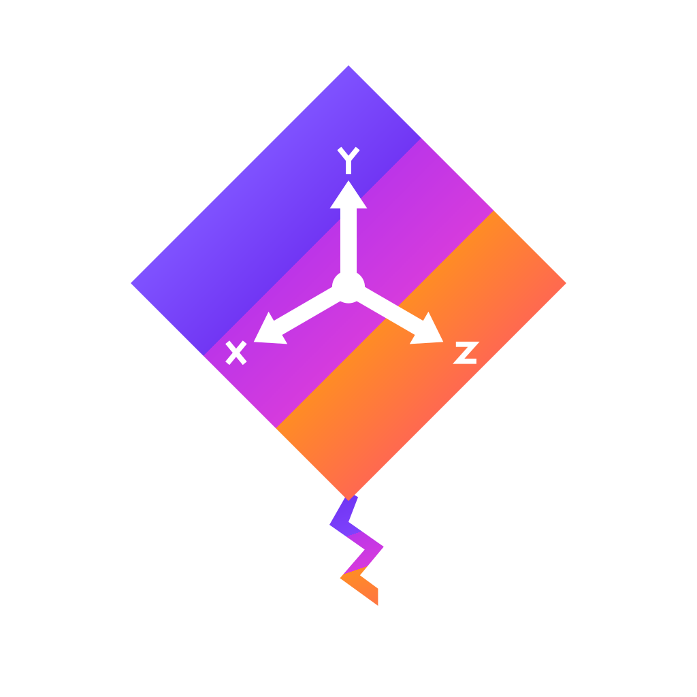

# Kite3D — Vector triad

Original logo concept created on 2026-09-05.

Three labelled coordinate vectors meet at a common origin: a flat mathematical diagram for vectors, matrices and spatial maths.

The shared short-tailed diamond and violet/magenta/orange palette connect it to the Kite family and Kotlin. Its internal geometry expresses this library's purpose, as documented in its repository README.

- [Editable SVG](kite3d-concept.svg)
- [1024 × 1024 transparent PNG](kite3d-concept.png)

Constructed directly as SVG paths, shapes, masks and gradients, extending the established KiteConfig diamond-and-tail geometry. No embedded raster image, external font, or external asset dependency. PNG rendered with librsvg. This is an artwork exploration; it has not replaced any application or documentation assets.
